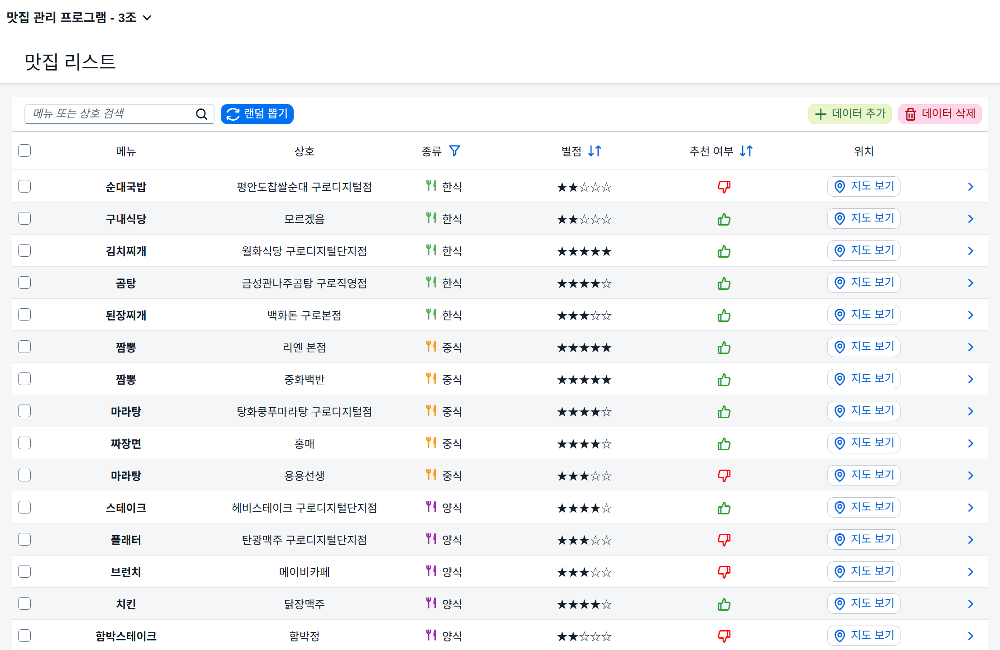
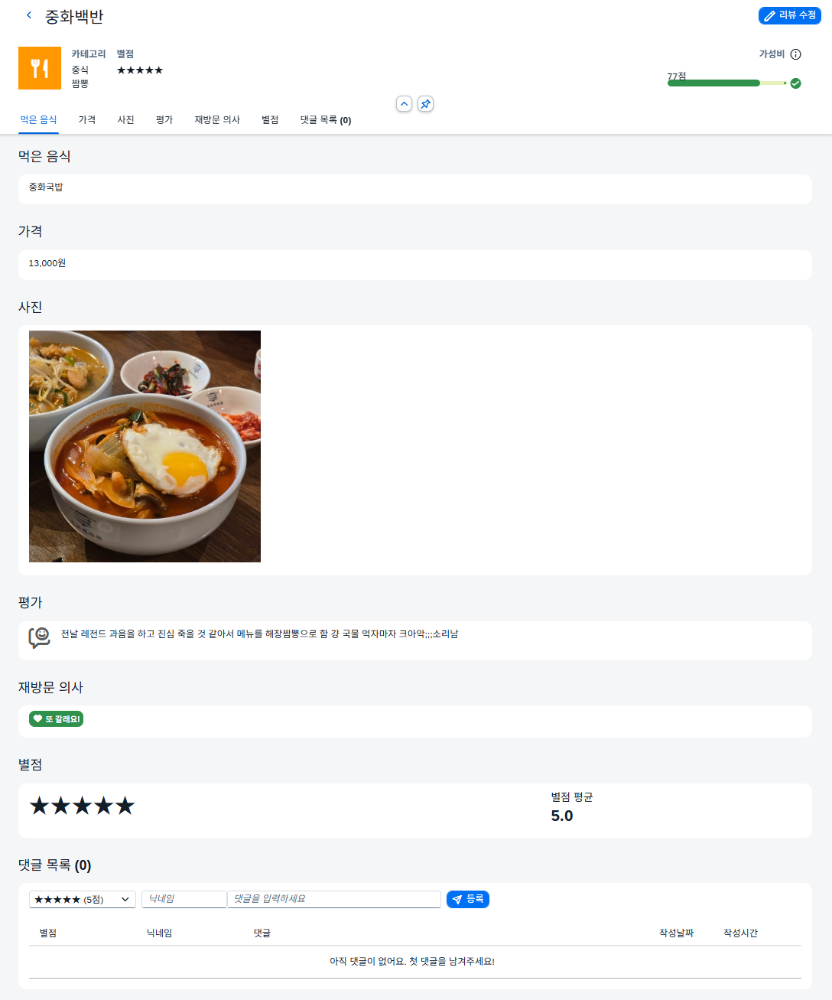

<div align="center">

# 맛집 관리 프로그램

**구로디지털단지 맛집 리스트**

맛집 리스트를 확인하고 관리할 수 있는 SAPUI5 웹 앱


`POU (Proof of Understanding) 미니 프로젝트` | `3조` | `2026.11.04 ~ 11.10`

</div>

---

## 목차

1. [프로젝트 소개](#프로젝트-소개)
2. [실행 화면](#실행-화면)
3. [주요 기능](#주요-기능)
4. [필수 조건 충족](#필수-조건-충족)
5. [기술 스택](#기술-스택)
6. [프로젝트 구조](#프로젝트-구조)
7. [데이터 구조](#데이터-구조)
8. [팀원 및 역할](#팀원-및-역할)
9. [개발 일정](#개발-일정)
10. [협업 규칙](#협업-규칙)
11. [참고 사항](#참고-사항)

---

## 프로젝트 소개

> "오늘 점심 뭐 먹지?"를 데이터로 해결하는 팀 맛집 노트

맛집 공유 탭의 맛집 리스트를 참고하여 팀원들이 한식, 중식, 일식, 양식 **26곳** 식당 기록을 데이터 파일로 작성하여 **SAPUI5 앱**으로 만든 프로젝트입니다.
각 식당의 메뉴, 가격, 후기, 재방문 의사를 정리했고,
목록에서 원하는 곳을 빠르게 찾은 뒤 상세 페이지에서 후기와 댓글을 확인할 수 있습니다.

| 목적 | 내용 |
| --- | --- |
| 학습 목표 | 팀 과제를 통해 SAPUI5의 **MVC, 데이터 바인딩, 라우팅, Fragment**를 직접 구현하며 이해도 높이기 |
| 주제 | 맛집 관리 프로그램 (맛집 공유 탭 → 맛집 리스트 참고) |
| 인원 | 4명 (2인 1조 단위로 기능 분담 후 통합) |

---

## 실행 화면

### 메인 화면 - 맛집 리스트



- 상단 툴바: 메뉴 또는 상호 검색, 랜덤 뽑기, 데이터 추가, 데이터 삭제
- 컬럼 헤더: 종류 필터 버튼, 별점과 재방문 의사 정렬 버튼
- 각 행: 체크박스(다중 삭제용), 종류별 색상 아이콘, 별점, 재방문 의사 아이콘, 지도 보기 버튼
- 행을 클릭하면 상세 화면으로 이동

### 상세 화면 - 맛집 정보



- 제목 영역: 뒤로가기 버튼, 상호명, 리뷰 수정 버튼
- 헤더: 종류별 색상 아이콘, 카테고리와 메뉴명, 별점, 가성비 점수 (안내 아이콘에 마우스를 올리면 계산 기준 표시)
- 앵커 바: 먹은 음식, 가격, 사진, 평가, 재방문 의사, 별점, 댓글 목록 섹션으로 바로 이동
- 본문: 천 단위 구분 기호로 표시한 가격, `sap.m.Image`로 표시한 음식 사진, "또 갈래요!" / "다신 안 가요"로 표시한 재방문 의사
- 별점 섹션: 별 모양 별점과 소수점 첫째 자리까지의 별점 평균
- 댓글 목록: 별점, 닉네임, 댓글 입력 후 등록 → 작성 날짜와 시간이 함께 기록되고 섹션 제목에 댓글 수 표시, 행마다 삭제 버튼
- 캡처 예시: 별점 5점, 13,000원 → 가성비 77점
---

## 주요 기능

### 메인 화면 - 맛집 리스트 (`DynamicPage`)

| 기능 | 설명 |
| --- | --- |
| **통합 검색** | 메뉴명 **또는** 상호명에 검색어가 포함된 맛집 찾기 |
| **종류 필터** | 데이터에 있는 종류(한식, 중식, 일식, 양식)로 목록을 자동 생성해 Popover에서 선택 |
| **검색 + 필터 동시 적용** | 검색어와 종류 조건을 기억해 두고 **AND로 묶어** 한 번에 적용 → 하나를 바꿔도 다른 조건이 풀리지 않음 |
| **2단계 정렬** | 별점, 재방문 의사 컬럼 정렬. 같은 열을 다시 누르면 방향 전환, 다른 열을 누르면 **이전 정렬은 2순위로 유지** |
| **랜덤 뽑기** | 전체 맛집 중 하나를 무작위로 골라 "오늘의 식당" Dialog로 발표 |
| **지도 보기** | 행마다 있는 버튼으로 해당 상호를 **네이버 지도**에서 검색한 페이지를 새 창으로 열기 |
| **맛집 추가** | SimpleForm Dialog에서 음식, 상호, 분류, 별점, 재방문, 이미지, 메뉴, 가격, 후기 입력 (빈 칸 검사) |
| **다중 삭제** | 체크박스로 여러 맛집을 골라 한 번에 삭제 |
| **보기 좋은 표** | 종류별 아이콘 색상, 별 모양 별점 표시, 재방문 의사 엄지 아이콘(좋아요/싫어요), 스크롤해도 고정되는 헤더, 줄무늬 행 |

### 상세 화면 - 맛집 정보 (`ObjectPageLayout`)

| 기능 | 설명 |
| --- | --- |
| **앵커 바 섹션** | 먹은 음식, 가격, 사진, 평가, 재방문 의사, 별점, 댓글 목록으로 바로 이동 |
| **가성비 점수** | 별점과 가격으로 0~100점을 계산해 ProgressIndicator로 표시 (75점 이상 초록, 40점 이상 주황, 그 외 빨강) |
| **별점 평균** | 원래 리뷰 별점 + 댓글 별점의 평균을 계산해 상세 화면과 **메인 목록에 함께 반영** |
| **댓글** | 별점, 닉네임, 내용을 입력하면 작성 날짜와 시간을 자동 기록, 삭제 가능, 섹션 제목에 댓글 수 표시 |
| **리뷰 수정** | 추가 Dialog와 **같은 Fragment를 재사용**해 기존 값을 채운 뒤 수정 (수정해도 댓글은 유지) |
| **사진, 가격** | `sap.m.Image`로 음식 사진 표시, 가격은 천 단위 구분 기호로 표시 (예: `12,000원`) |

<details>
<summary><b>계산식 자세히 보기</b></summary>

**가성비 점수**

```
가성비 = min(100, 별점 * 2 * 100,000 / 가격)
```

예) 별점 4점, 11,000원 → `4 * 2 * 100,000 / 11,000 = 약 72.7` → 반올림해서 73점 (주황)

**별점 평균**

```
평균 = (원래 리뷰 별점 + 댓글 별점의 합) / (댓글 수 + 1)
```

예) 원래 4점 + 댓글 5점, 3점 → `(4 + 5 + 3) / 3 = 4.0`
목록의 별 모양 표시는 반올림한 값이고, 상세 화면에는 소수점 첫째 자리까지 함께 표시합니다.

</details>

---

## 필수 조건 충족

| 필수 조건 | 충족 | 사용 위치 |
| --- | :---: | --- |
| `sap.m.Image` 사용 | O | Detail 화면의 사진 섹션 |
| 상세 페이지 사용 | O | `Detail.view.xml` (Main 행 클릭 시 이동) |
| ObjectPage / DynamicPage / FCL / SplitApp 중 1개 이상 | O | **DynamicPage** (Main) + **ObjectPageLayout** (Detail) |

---

## 기술 스택

| 구분 | 사용 기술 |
| --- | --- |
| **Framework** | SAPUI5 1.154.0 (`sap.m`, `sap.f`, `sap.uxap`, `sap.ui.layout`) |
| **Theme** | SAP Horizon (`sap_horizon`) |
| **Architecture** | MVC (XML View + Controller), Component, manifest 기반 Routing |
| **Data** | `JSONModel` (`model/data.json`), Expression Binding, Formatter, Data Type (`Integer`) |
| **UI 패턴** | Fragment (Dialog, Popover), Filter / Sorter, URLHelper |
| **Tooling** | SAP Business Application Studio, SAP Fiori Tools (`fiori run`), UI5 Tooling CLI 4 |
| **Collaboration** | Git / GitHub |

---

## 프로젝트 구조

```
mini_project_261105
|-- webapp
|   |-- controller
|   |   |-- App.controller.js       # 루트 컨트롤러
|   |   |-- Main.controller.js      # 검색, 필터, 정렬, 랜덤, 지도, 추가, 삭제
|   |   `-- Detail.controller.js    # 상세 바인딩, 댓글, 별점 평균, 리뷰 수정
|   |-- view
|   |   |-- App.view.xml            # sap.m.App (페이지 컨테이너)
|   |   |-- Main.view.xml           # 맛집 리스트 (DynamicPage + Table)
|   |   |-- Detail.view.xml         # 맛집 상세 (ObjectPageLayout)
|   |   `-- fragment
|   |       |-- Dialog.fragment.xml # 맛집 추가/수정 공용 Dialog
|   |       |-- Filter.fragment.xml # 종류 필터 Popover
|   |       `-- Random.fragment.xml # 랜덤 뽑기 결과 Dialog
|   |-- model
|   |   |-- data.json               # 맛집 데이터 (26곳)
|   |   |-- formatter.js            # 별점 숫자를 별 모양 문자열로 변환
|   |   `-- models.js
|   |-- i18n/i18n.properties
|   |-- css/style.css
|   |-- Component.js
|   |-- manifest.json               # 앱 설정, 모델, 라우팅
|   `-- index.html
|-- DetailPage.png                  # README용 상세 화면 캡처
|-- MainPage.png                    # README용 메인 화면 캡처
|-- README.md
|-- ui5.yaml
|-- ui5-local.yaml
|-- eslint.config.mjs
`-- package.json
```

---

## 데이터 구조

`webapp/model/data.json`을 `manifest.json`에서 기본(이름 없는) `JSONModel`로 등록해 사용합니다.

```jsonc
{
  "food": [
    {
      "name": "순대국밥",                       // 먹은 음식 (메뉴명)
      "store": "평안도찹쌀순대 구로디지털점",     // 상호명
      "type": "한식",                           // 분류: 한식 | 중식 | 일식 | 양식
      "star": 2,                                // 별점 1~5
      "visit_again": false,                     // 재방문 의사
      "image": "https://...",                   // 음식 사진 URL
      "detail": [
        { "menu": "순대국밥", "price": 9000, "review": "..." }
      ]
    }
  ]
}
```

실행 중에는 상세 화면에서 아래 속성이 맛집 항목에 추가됩니다.

| 속성 | 설명 |
| --- | --- |
| `comments` | 댓글 배열 `{ CommentStar, name, comment, date, time }` |
| `originStar` | 평균 계산 전 원래 리뷰 별점 (`star`에는 평균값이 저장됨) |

| 분류 | 한식 | 중식 | 일식 | 양식 | **합계** |
| --- | :---: | :---: | :---: | :---: | :---: |
| 맛집 수 | 7 | 5 | 7 | 7 | **26** |

---

## 팀원 및 역할

| 팀원 | 주요 작업 |
| --- | --- |
| **오상민** | - 프로젝트 초기 세팅<br>- `data.json` 한식 카테고리 작성<br>- 화면 구조 전환 (FCL → 페이지 이동 방식)<br>- 메뉴/상호 통합 검색<br>- 검색과 종류 필터 동시 적용<br>- 2단계 정렬 유지<br>- 랜덤 뽑기<br>- 네이버 지도 연동 |
| **김효은** | - `data.json` 중식 카테고리 작성<br>- 종류별 Filter (Popover 사용)<br>- 별점 및 재방문 의사 정렬 (Sorter)<br>- 리스트 선택 및 데이터 삭제<br>- Expression Binding으로 재방문 의사를 기호로 표기 |
| **김진서** | - `data.json` 일식 카테고리 작성<br>- Detail View를 Object Page로 구성<br>- 댓글 작성, 삭제 기능<br>- 댓글의 별점을 포함한 평균 별점 계산<br>- 맛집 정보 수정 시 기존 댓글 유지 |
| **이도연** | - `data.json` 양식 카테고리 작성<br>- 맛집 추가<br>- 맛집 수정<br>- 별점과 가격을 이용한 가성비 점수 (ProgressIndicator)<br>- 종류별 아이콘과 색상 표시<br>- 댓글 목록 제목에 댓글 수 표시 |

---

## 개발 일정

| 날짜 | 단계 | 내용 |
| --- | --- | --- |
| 11/04 (수) | 시작 | POU 주제 공지, 기획 |
| 11/05 (목) | 설계 | JSON 데이터 구성, 대략적인 UI 설계, 프로젝트 세팅, 라우팅 골격 |
| 11/06 (금) | 개발 | 검색, 필터, 정렬, 랜덤, 지도 / 상세, 댓글, 별점 평균 / 추가, 수정, 삭제 |
| 11/07 ~ 08 | 보완 | 댓글 작성 일시, 댓글 삭제, 별점 평균 오류 수정, 리뷰 데이터 보강 |
| 11/09 (월) | 통합 | 각자 개발한 내용 합치기 |
| 11/10 (화) | 발표 | 최종 테스트 및 조별 발표 |

---

## 협업 규칙

**커밋 메시지**

| 타입 | 용도 | 예시 |
| --- | --- | --- |
| `feat` | 새 기능 | `feat: 지도 보기 버튼을 누르면 해당 상호명을 검색한 지도 페이지 열기` |
| `fix` | 버그 수정 | `fix: 별점 평균 계산 오류 및 맛집 수정 시 댓글 삭제 문제 수정` |
| `refactor` | 동작 변화 없는 개선 | `refactor: FCL 구조에서 DynamicPage로 변경` |
| `docs` | 문서, 주석 | `docs: Main controller에 주석 추가` |
| `merge` | 브랜치 병합 | `merge: 팀원 작업과 합침` |

**작업 흐름**

1. 작업 전 항상 `git pull origin main`
2. 기능 단위로 작게 커밋
3. 충돌이 나면 `<<<<<<<` / `=======` / `>>>>>>>` 구간을 확인해 양쪽 코드를 합친 뒤 커밋
4. push 전 앱을 실행해 동작 확인

---

## 참고 사항

- 맛집 추가, 수정, 삭제와 댓글은 브라우저 메모리의 `JSONModel`에만 반영됩니다. **새로고침하면 `data.json`의 원래 데이터로 돌아갑니다.**
- 음식 사진은 외부 이미지 URL을 사용하므로, 네트워크 환경에 따라 표시되지 않을 수 있습니다.
- 지도 보기는 네이버 지도 검색 페이지(`map.naver.com/p/search/상호명`)를 새 창으로 엽니다.

---

<div align="center">

**맛집 관리 프로그램 | 3조**

</div>
